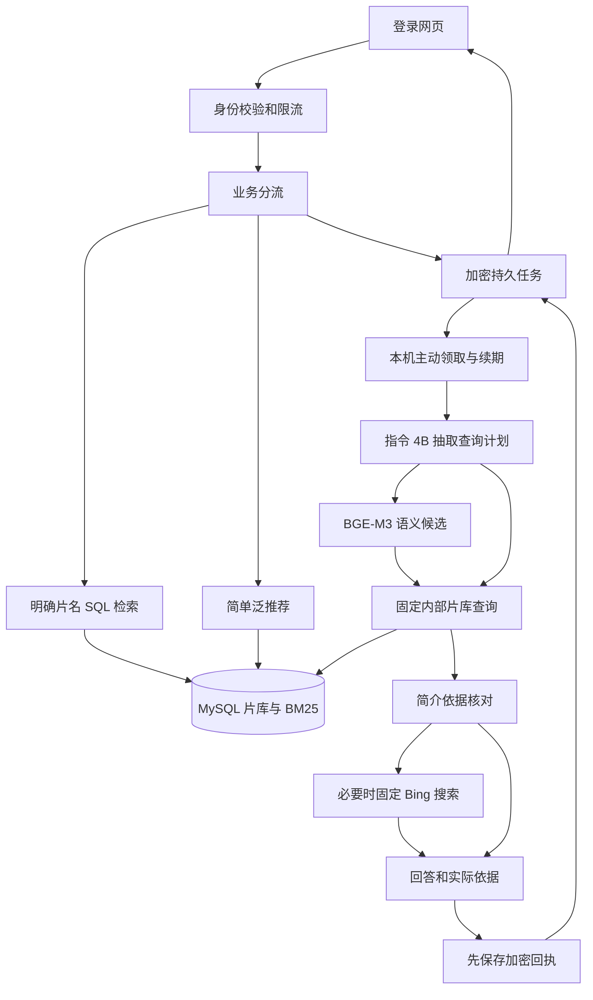
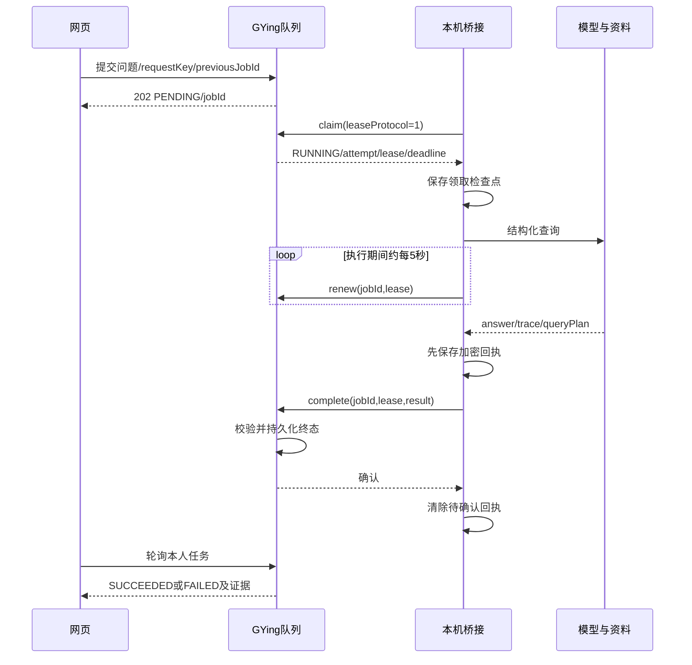

# GYing AI 架构：从问题到可核查回答

机制按 2026-10-25 源码整理，部署事实截至当日 17:26。版本、包 hash 与回退见[当前状态](current-project-status.md)和[发布台账](history/releases.md)。本文解释当前系统；历次测试结果见[评测手册](ai-evaluation.md)。

## 1. 系统各层负责什么

| 层 | 职责 | 事实来源 |
| --- | --- | --- |
| Next.js 网页 | 登录、提问、历史、任务轮询、候选和依据展示 | [AI 页面](../frontend/src/app/ai-assistant/page.tsx)、[API 客户端](../frontend/src/lib/api.ts) |
| GYing backend | 身份与限流、确定性检索、偏好推荐、任务与服务端上下文 | [控制器](../backend/src/main/java/com/gying/movie/controller/AiAssistantController.java)、[队列](../backend/src/main/java/com/gying/movie/service/impl/AiAssistantService.java) |
| 本机 Agent | 结构化条件抽取、语义召回、简介相关性核对、受控联网与回执 | 另一仓库 `local-ai-agent/backend/src/main/java/com/localai/agent/assistant/` |
| Ollama | 运行模型；影视研究使用指令 4B，工作区聊天保留 1.7B；BGE-M3生成向量 | 本机配置及 Agent `OllamaService` |
| MySQL | 影片身份、主创、评分、简介、审核资源与用户互动的业务来源 | [数据库](database.md)、[片库服务](../backend/src/main/java/com/gying/movie/service/impl/CatalogResearchService.java) |

Agent 表示模型在受控流程中使用资料和工具完成任务。Harness 是包住执行的权限、预算、上下文、trace、租约和恢复机制。评测器是发送问题并检查结果的外部程序。三者职责分开，不能把模型输出、执行成功和回答正确混为一谈。



## 2. 网页提交和分流

网页通过同域 `/api/ai/query` 提交 message、history、随机 requestKey 和未过期的 previousJobId。后端从已验证登录身份取得 userId，客户端不能自行指定用户。每次轮询也重新检查任务归属。当前网页每约 2.5 秒读任务状态，客户端等待上限约 250 秒。

[CatalogAiService.answer](../backend/src/main/java/com/gying/movie/service/impl/CatalogAiService.java)仅直接处理两类首次问题：明确命中片库的片名、简单泛推荐。复杂条件、联网、详情和追问进入任务流程，不再由单个“推荐”字眼覆盖整句要求。单独的 `/api/ai/natural-search` 仍提供规则解析与 BM25 分页，它和新结构化研究路径不是同一个入口。

普通标题检索由 SQL 计算完整数量并分页，使用参数绑定与 LIKE 通配符转义；1–2 字短片名要求完整身份匹配，避免任意字眼扩展成大量候选。模型不承担遍历片库和计算总数。

## 3. 结构化计划如何执行

本机 `MovieQueryPlanner` 使用受限 JSON Schema，抽取 intent、titles/seedTitle、主创及排除、年份、类型、评分来源、时长、数量、排序和上一轮范围。输出是数据，不是 SQL、URL 或动作指令。原问题和片库人物字段参与校验；不清楚的条件保留为待核验或澄清。

查询示意：

```json
{"intent":"search","genresAll":["科幻"],"yearFrom":2011,"ratingSource":"douban","minRating":8,"excludedDirectors":["克里斯托弗·诺兰"],"limit":2}
```

这是解释格式的示例，不是某次实际模型输出。实际执行计划要看该次 queryPlan；小模型仍可能把“2010年之后”处理成包含2010的范围，人物子串也可能引入额外排除。确定性过滤能忠实执行计划，但不能自动证明计划理解了原问题。

[CatalogResearchController](../backend/src/main/java/com/gying/movie/controller/CatalogResearchController.java)只接受固定内部接口、桥接认证和有界字段。网站任务的 job/lease 校验后，后端从本人上一轮成功结果构造上下文。[MovieQueryPlan](../backend/src/main/java/com/gying/movie/service/impl/MovieQueryPlan.java)执行范围继承；“第2部”对应服务端候选顺序，不能让模型编一个片库ID。受控本机直接查询允许空任务上下文，这不绕过桥接认证。

候选的年份、分类、主创排除、明确评分来源等由[CatalogResearchService](../backend/src/main/java/com/gying/movie/service/impl/CatalogResearchService.java)核对实际元数据。缺失字段、演员是否主演/客串、奖项、内容镜头、地区版权等仍有数据契约限制；不能把未知写成满足。

## 4. BM25、embedding 与融合

| 环节 | 当前实现 | 作用与限制 |
| --- | --- | --- |
| BM25 | ICU 分词、倒排和片名/别名/主创/简介权重 | 对明确用词有效；词义近似和泛剧情会漏召回或误召回 |
| embedding | BGE-M3、1024维归一 float32，公开元数据文件索引 | 用向量内积计算相似候选；相似分不是正确概率，不替代年份/人物过滤 |
| 融合 | RRF按排名融合；每路有界候选 | 单路贡献约 `1/(60+rank)`，避免直接相加尺度不同的BM25与向量分 |
| 相似影片特征 | 类型/主创等已有内容特征参与候选 | 补充参照片方向；题材接近不等于场景完全相同 |
| 相关性核对 | 指令4B结合实际简介摘录筛选候选 | 可以减少明显偏题，仍有误判；与独立交叉编码器reranker不是一回事 |

本机 `SemanticMovieIndex` 对向量逐条计算内积并保留前100个，是有界本机文件索引，没有部署专用向量数据库或ANN服务。服务端验证id、score和当前片库fingerprint，过滤已过期向量、明确硬条件和低相似分后再融合。

索引包含公开影片元数据，不含用户、凭据或资源URL。文件绑定模型digest、维度和片库fingerprint；模型或格式不匹配拒绝使用。索引异常回退BM25，不放开硬条件。线上查询embedding使用CPU，避免4GB显存同时驻留第二份GPU模型；初始化可以在受监督空闲窗口另行构建。

2026-10-25生效索引为11,272条；原10,432留出快照与11,220开发对照快照分别冻结。构建器复用digest隔离缓存、核对模型、保留旧文件并原子发布。常规定期增量调度尚未登记/验收；不要把一次增量构建说成持续自动更新。

## 5. 推荐如何利用用户行为

[CatalogRecommendationEngine](../backend/src/main/java/com/gying/movie/service/impl/CatalogRecommendationEngine.java)预计算不可变稀疏影片特征：类型权重0.50、导演0.15、演员0.10、分类0.10，年代/地区/语言各0.05，另有字段归一与类型IDF。这是可解释规则特征，不是训练出来的embedding。

用户特征聚合最多100条收藏和100条近90天浏览：收藏权重3，浏览权重 `exp(-days/30)`，30天剩约36.8%，不是半衰期。收藏/已看排除；userId只用于读取本人行为，不作为影片语义特征。

排序结合内容0.55、共同收藏0.20、评分0.15和热度0.10；共同收藏要求独立用户支持，冷用户使用评分/热度并说明原因，另有多样性重排。相关推荐以当前影片为种子。没有持久Feature Store、线上CTR实验或推荐模型训练。

## 6. 什么时候真正联网

本机 `GyingResearchService` 在明确联网、片库无候选或存在片库不能核验的条件时调用固定 `MovieSearchTools`。当前请求真实 Bing 搜索HTML，限制响应、来源域名及候选数量，然后检查条目身份和实际摘要。模型不能指定请求主机或执行搜索结果里的指令。

来源链接用于引用，程序不会逐页抓取目标网页。2026-10-25《莫扎特传》实际搜索原始2条，排除同名TV1条并保留IMDb1条；这证明联网调用发生，不证明IMDb目标页剧情、平台版权或外部下载可用。旧原生工具的Wikipedia摘录路径保留兼容；不能再把它描述成当前研究唯一联网来源。

有用的主题近似可以返回，但必须列出依据。没有足够资料时说明未知、澄清或保留已核实片库结果，不能为了凑够数量编影片。明确排除仍按条件处理，偏题候选需要质量复核。

## 7. 租约、回执与恢复



| 机制 | 当前保证 | 边界 |
| --- | --- | --- |
| 提交幂等 | 同用户、同requestKey、同请求复用；换内容409 | 有保留窗口；用户重新提交会产生新key |
| 队列容量 | 最多200条保留记录、8个未完成任务、一个RUNNING | 单实例、有界吞吐，未实现分布式队列 |
| 租约 | 新协议45秒、约5秒续期，创建后240秒总上限 | 旧协议210秒；续期不允许无限执行 |
| attempt | 可续期租约丢失最多再领取一次 | 新attempt可能再次推理，不承诺全局exactly-once |
| 回执幂等 | 同lease同结果hash重复complete成功 | 过期lease、取消、矛盾回执409，不覆盖新状态 |
| 本机恢复 | 完整result仅重传；只有领取检查点则报告中断 | 不从工具循环中间继续计算 |
| 用户取消 | 本人DELETE使任务失败并拒绝旧回执 | 网页Abort不自动DELETE，已发模型请求不立即停止 |
| 状态保留 | 未完成保存问题；终态移除问题/历史，结果约15分钟清理 | 临时状态不是长期审计库，备份密文另有保留周期 |

| 状态配置 | 现役用途 |
| --- | --- |
| APP_AI_STATE_FILE / APP_AI_STATE_KEY_FILE | Movie队列文件与独立只读私有key；生产队列在backend-data专用ai-state子目录 |
| LOCAL_AI_GYING_STATE_FILE / LOCAL_AI_GYING_STATE_KEY_FILE | 本机回执文件与独立key；.local/ai-state/bridge.bin与受限gying-state-key.bin不进Git |

默认契约为空，未启用的环境不能凭文件存在推断持久化；配置只给其一会拒绝启动。当前生产已明确启用，恢复state需要对应key并核权限/目标origin。

两侧AES-GCM状态文件使用独占写锁、随机nonce、受限权限与临时文件原子替换；写入失败、错误key或占用阻止继续。生产已经启用，两套key独立保存在仓库外。单文件写锁不是跨机器事务；应用回退保留新state/key，不恢复旧SQL覆盖数据。

## 8. 预算、可用性与工具边界

研究路径受原180秒总体执行预算；片库connect2秒、read/call30秒且不超过剩余deadline；联网有独立短时限。原生工具循环最多4次工具、6轮，4096上下文和保守字符估算会裁剪历史/证据，不能当作真实token usage。

网站检查桥接heartbeat，短窗口无心跳会认为模型未连接。2026-10-25四本机服务消失与冷片库超过旧10秒read是两处独立可用性问题；现役受管启动器使用WMI独立隐藏宿主并校验实例，避免跟随调用方Job退出的风险。终止的唯一原因未完全确认，修复和真实验证见[可用性记录](history/releases.md#ai-availability-20261025)。

工作区local模式仅允许四项只读工具；影视研究只访问固定业务接口。没有SQL执行、任意HTTP、写文件、转存或发布工具。旧MCP含命令/写入/外发能力，当前网页没有直接连接它；Spring AI MCP依赖存在不等于已经完成ChatClient迁移或只读影视MCP服务。

## 9. 如何核查一次回答

先看实际queryPlan是否表达原要求，再看候选身份、评分来源和简介。trace中的planning、retrieval、tool及耗时证明执行到了哪里；evidence中的queriedAt说明本次读库时间，NORMAL和validatedAt仅说明历史资源检查状态。最后单独判断回答是否忠于依据、是否对用户有用。

本机TraceStore最多200条内存记录，重启不保留；网站临时加密结果和脱敏评测报告是另外两类证据。HTTP200、completed/SUCCEEDED、调用过工具、人工答对分别评估。持久usage、按用户成本账本、独立盲评、文档RAG和线上点击评价仍在[求职路线](ai-career-roadmap.md)中。

## 10. 源码阅读顺序

先读[网页](../frontend/src/app/ai-assistant/page.tsx) → [AiAssistantController](../backend/src/main/java/com/gying/movie/controller/AiAssistantController.java) → [CatalogAiService](../backend/src/main/java/com/gying/movie/service/impl/CatalogAiService.java) → [AiAssistantService](../backend/src/main/java/com/gying/movie/service/impl/AiAssistantService.java) → [CatalogResearchService](../backend/src/main/java/com/gying/movie/service/impl/CatalogResearchService.java)。

另一仓库对应顺序为 `GyingBridge → AssistantService.runForJob → MovieQueryPlanner → GyingResearchService → SemanticMovieIndex/GyingCatalogClient/MovieSearchTools → 加密回执`。本机检出为 `D:/ai/local-ai-agent`，路径是这台主机的事实，不是仓库通用安装要求。
