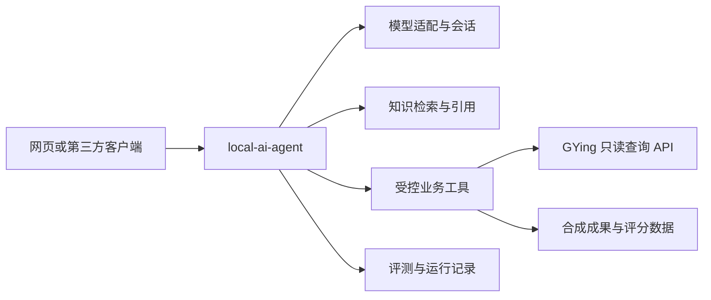

> 归档说明：正文保留 2026-10-16 的分析和当时验证边界，不能作为当前运行状态。2026-10-21 实现、2026-10-22 部署的推荐特征/自然搜索进度见 [本轮交付报告](catalog-features-search-20261021.md)。原绝对路径是旧机器证据位置，不随本仓库克隆提供。

**AI 开发求职分析与项目补强路线｜2026-10-16**

本报告把现有简历、在职 Java 项目、GYing Movie 和新补充的 local-ai-agent 一起评估。结论：以「Java 后端 + AI 应用开发」为主线；在职项目证明业务交付，GYing 证明独立系统工程，local-ai-agent 补齐可演示、可评测的 AI 能力。优先完成一个 AI 服务和一个业务连接器，避免同时重造三个系统。

这是源码与材料分析，不是招聘结果预测。本次没有修改三个项目的业务源码、部署服务、提交代码或发送外部消息。没有把 README 的计划内容、过去的在线观察、配置文件里的模型名称当成本次运行验证。

**1. 材料与验证边界**

- 简历：`D:/gying-movie/简历/简历4.0.pdf`，两页；已提取正文并渲染检查。
- 在职项目：`E:/lide_project/rear-expert`；用户说明这不是最新版本，因此只判断当前副本可见实现，不据此断言公司的线上情况。未读取业务数据库和真实成果材料。
- GYing：`D:/gying-movie/movie`；结合当前代码、状态手册及 2026-10-15 的审查报告。旧报告中的生产数据和问题均保留原证据日期。
- local-ai-agent：从用户提供的 GitHub 仓库下载独立审查副本，提交 `dacb308`（Git 日期 2026-10-16）。本次分析针对该提交。
- 原聊天及旧子智能体日志没有留下完整分析结论；本报告直接重新核对材料，没有把中断标记当作任务成功。
- 实际运行了原始 Node 路由函数的离线夹具，HTTP 与 Express 均用 mock，不连接模型、不执行文件工具、不触发机器人。
- 独立审查副本中执行前端依赖安装（禁用安装脚本）和 `npm run build`，构建成功；有大 chunk 和构建工具提示。依赖由当前允许范围解析，因此不把这次结果等同于作者原机器的依赖组合。未启动前端或后台服务。
- 未完成后端启动、真实模型推理、MCP 握手、QQ/飞书发送、外部 RAG 端到端验收。仓库 `backend/src/test` 下没有测试文件；本机未在 PATH 或文档声明的位置找到 Maven，不能报告后端编译通过。

**2. 三个项目分别怎么帮简历加分**

| 项目 | 已有证据支持的价值 | 当前适合的定位 | 下一步最值得做的事 |
|---|---|---|---|
| rear-expert | 成果导入校验、重名人员处理、批量写入、审核历史、规则计分、按年/类别/部门等维度统计 | 在职业务项目，展示需求落地与数据处理 | 先重写项目经历；另用合成数据做评分解释/统计问答演示 |
| GYing Movie | 多来源适配、元数据归一、采集游标、任务重试、资源治理、网页/QQ 共用查询流程、发布状态保护 | 独立开发维护的内容检索与资源管理系统 | 整理工程案例；抽取只读查询 API 供 AI 服务调用 |
| local-ai-agent | Java MCP 工具注册、llama.cpp/Ollama 调用封装、聊天 UI、语义分类路由骨架、文件/日志/消息工具 | 本地模型与工具服务原型 | 补齐受控工具调用、知识检索、真实运行轨迹和评测 |

我的排序是：先把简历中的现有工作经历补上；把新增 AI 代码主要放在 local-ai-agent；用 GYing 做第一个业务连接器。企业场景演示随后使用自行构造的数据，不复制公司源码、真实人员信息和内部材料到个人仓库。

投递方向可优先考虑 Java AI 应用开发、智能体后端、企业知识库/业务助手开发。是否匹配具体岗位仍要逐条看 JD；当前证据不能支持「大模型训练、算法研究、推理内核优化」这些定位。

**3. local-ai-agent：哪些是真的，哪些还没闭环**

| 能力 | 核查结果 | 代码位置 |
|---|---|---|
| 本地模型调用 | 有 OkHttp 调用、system/user 消息构造、响应解析；未测实际模型质量与速度 | `backend/.../ollama/LlamaService.java:95,179,207` |
| MCP 工具注册 | `MethodToolCallbackProvider` 注册三类工具；源码共有 17 个 `@Tool` 方法 | `backend/.../config/McpToolsConfig.java:43` |
| 工具清单 UI | 硬编码 16 个工具，不是本次 MCP 实际发现结果 | `frontend/src/views/Tools.vue:5,31` |
| 语义路由 | 有分类调用和路由表；schema 未加入请求，分类 prompt 也未说明五个合法标签；异常退到 chat | `router-layer/server.js:17`；`router-layer/router.json:8` |
| 自主工具执行 | `tool` 与 `code` 均路由 `/api/chat`；Controller 只调用模型，模型请求没有工具 schema/结果回传循环 | `router-layer/router.json:28,37`；`AdminController.java:82`；`LlamaService.java:179` |
| 多轮对话 | 前端保存消息数组，但每次仅发送当前 text/system/engine；后端只组装 system + 当前 user | `frontend/src/views/Chat.vue:118,156`；`frontend/src/api/index.js:38` |
| 流式输出 | 当前模型调用显式 `stream=false` | `LlamaService.java:184`；`router-layer/server.js:27,52` |
| RAG | 只看到转发到外部 `/api/rag`；没有仓库内的解析、切块、索引、召回、引用和更新闭环 | `router-layer/server.js:66`；`router-layer/router.json:33` |
| 实时日志 | Logs 页调用 `/status`，在浏览器内追加状态文本 | `frontend/src/views/Logs.vue:44` |
| 推理错误 | 模型异常转换为字符串，再被 Controller 包装为 success，业务状态与结果不一致 | `LlamaService.java:108`；`AdminController.java:108` |
| 超时 | Node HTTP 调用未设置 timeout；Java 工具先阻塞读 stdout，再 waitFor，静默子进程可能迟迟进不到超时判断 | `server.js:24,49,58,67`；`SystemTools.java:125,134`；`DevTools.java:363,373` |
| 工具边界 | 已有 normalize/startsWith 路径检查、命令白名单和连接符拦截；仍没有操作系统级隔离，允许 node/java/npm 等执行程序不能等同于沙箱 | `DevTools.java:339`；`SystemTools.java:57,84,297` |
| 机器人 | 有 Webhook 与发送工具代码；QQ 事件入口返回模型文本，没有直接调用发送服务；外部 OpenClaw 的记录不代表这一路已验收 | `QQBotService.java:90`；`AdminController.java:113`；`docs/openclaw-qqbot-runbook.md` |

关键区别：MCP Server 可以把工具提供给外部智能体，这是已有代码价值；但本项目自己的聊天路由尚未实现工具选择、执行和工具结果回传的循环。不能由此写成已完成的自主多步骤 Agent，也不能说整个仓库没有 AI。

公开展示时建议把名称暂改成「本地模型与 MCP 工具服务原型」，待核心链路完成后再升级为「面向业务数据的本地 AI 助手」。README 的「完全离线、数据不出本机」也应限定为实际验证过的本地推理模式；启用 QQ/飞书和外部编排客户端后，应另说明数据流向。

暂时不值得继续扩充模型数量、机器人渠道、任意命令工具、通用代码生成按钮。这些已有部分雏形，当前更缺可验证的执行过程。

**4. 现有两个业务项目，简历应该写到什么层次**

**在职项目：把“录表格、做大屏”写成业务链路。**

代码证据包括：

- `ExcelExpertAchievementServiceImpl.java:773`：导入前读取基础字典和已有成果，处理人员关联与重名冲突。
- 同文件 `:1000`、`:1478`：重复行报告、异常数据记录、成果和人员关联批量写入。
- 同文件 `:2190`：审核状态变更及审核历史。
- `ExpertPersonScoresServiceImpl.java:368`：按成果分类、分支、等级、奖项、名次等匹配计分规则，保存分数明细。
- `ExpertRulesServiceImpl.java:62`：评分规则缓存；当前实现不能自动表述成通用规则引擎或多租户隔离。
- `ExpertStatisticsServiceImpl.java:197,1140`：时间/类别筛选、逐级统计钻取等实现；不能凭一个旧副本宣称全部统计接口均可运行。

可用于简历的草稿，提交前按真实职责调整“负责/参与”：

> 参与成果与人才评价平台后端开发，覆盖成果导入、人员匹配、审核流转、规则计分和多维统计，为成果管理和评价分析提供统一数据服务。
>
> 实现成果导入中的字典校验、重复记录识别及同名人员匹配，结合异常记录反馈与批量写入维护成果、人员及关联数据。
>
> 围绕成果分类、等级、奖项及排名条件实现规则计分与分数明细，支持按年份、类别等维度统计和钻取展示。

先确认自己真正承担的模块，不把若依自带登录、权限框架或代码生成器写成独立研发。不要编造服务人数、数据量、导入提速比例、审核效率。

**GYing：突出可靠性与业务治理。**

> 开发并维护影视元数据与资源管理系统，适配多来源查询和采集，将来源记录归一到统一影片与资源模型，支持审核、去重和软删除。
>
> 构建异步采集与资源处理流程，维护页码/页内游标、失败重试和任务状态；针对不同来源实现超时和回退策略，保留外部失败的核查依据。
>
> 打通网页与 QQ 查询入口，结合缓存限流、任务状态查询和发布审计，支撑多服务部署、验证与回滚。

这三句仍须以自己的实际工作为准。不要升级成“百万并发”“分布式调度平台”“全局 exactly-once”。网页搜索任务当前放在进程内 Map，重启可能失效；Resource Hub 的数据库任务与它不是同一种持久化保证。

2026-10-15 旧审查中的跨任务消费、provider 分流、账号字段覆盖、发布审核资格等问题，应在对应服务对 AI 开放前解决或避开相关写入口。本次没有重新验证或修复这些问题，不能写“安全门禁全部通过”。

**5. 推荐的整合方式与第一版范围**

这是目标设计，不是现有架构说明。保留业务数据与权限判断在业务服务中；AI 服务负责理解问题、调用已授权工具和组织带依据的答案。

第一版建议只完成三个工具：`search_movies`、`get_movie_details`、`get_resource_status`。查询状态返回实际查验时间和来源，只允许已审核、可见的数据；模型不得凭空构造影片、评分或资源链接。先在演示数据上实现，公开演示可以只展示元数据和状态。

演示对话例如：

- “找近几年偏烧脑、时长不超过两小时的科幻电影。” → 将明确条件变成结构化筛选；模糊偏好用语义检索；结果必须来自库内。
- “第二部为什么适合我？” → 使用上轮候选 ID 与已有资料解释，不能重新猜“第二部”。
- “它现在有可用资源吗？” → 调用状态工具，说明最近检查结果和时间；没有足够证据时明确回答未知。

这一个流程即可覆盖结构化输出、多轮指代、检索、工具调用、结果依据、状态时效与降级，不需要一开始增加更多框架。

接着再做一个企业场景：用合成的成果、评分规则和人员数据回答“这项成果为什么是这个分数”。由确定性的业务代码计算分数，AI 引用规则版本和分数明细解释。最后才考虑从自由文本或附件中抽取成果字段。

**6. 更多可选功能：按投入价值排序**

| 建议 | 最小可演示能力 | 优先级与验收重点 |
|---|---|---|
| 受控工具调用助手 | 问题→选择只读工具→查询→带依据回答 | 第一优先；执行轨迹可见，越权与超时有确定行为 |
| 带来源的知识问答 | 公开文档/自写说明导入，切块、检索、引用、无答案拒答 | 第一优先；引用能回到真实段落，删除文档后检索也删除 |
| 自然语言影片检索 | 硬条件过滤 + 语义检索 + 可解释结果 | GYing 首个场景；与现有关键词搜索做同题比较 |
| 评分解释助手 | 规则检索 + 明细工具，解释为什么得分/缺哪些字段 | 企业演示优先；数值由程序算，版本和范围明确 |
| 统计问答 | 自然语言转为年份/类别/部门等参数，调用固定统计接口 | 第二阶段；先支持 5–10 类问题，不开放任意 SQL |
| 智能成果录入 | 表头映射、字段抽取、缺项/冲突提示、确认后导入 | 第二阶段；字段准确率、人工修正量、来源定位 |
| 元数据消歧助手 | 对同名、年份、别名、季数给出匹配候选与理由 | 第二阶段；低确定性转人工，不能直接合并/删除记录 |
| 任务诊断助手 | 查询失败任务与脱敏日志，引用错误点和操作文档 | 第二阶段；先只读诊断，不能自动重放未知发布结果 |
| 发布草稿助手 | 基于已审核的内容生成标题和摘要 | 可选；展示事实来源和人工确认，避免把文案生成当唯一 AI 亮点 |
| 自训练大模型/通用多智能体平台 | 另建复杂技术体系 | 暂缓；当前没有证据说明这比完成已有主链路更有价值 |

不要把全部方案一次开工。我的首选是“工具调用 + 带依据检索 + GYing 查询连接器”；评分解释演示适合后续投企业 AI 应用岗位时追加。

**7. 你提到的“提供 API 给别人调用”，值得做什么**

GYing 已有 `GET /api/movies/list` 等 HTTP 接口；local-ai-agent 也有 `/api/chat` 和 `/api/agent`。新增 Controller 本身不是最强亮点。我建议做一个可复用的小型开发者服务，证明第三方能以明确契约消费能力。

建议的第一版契约（以下均未实现）：

- `GET /v1/movies/search`：检索元数据，支持结构化条件与稳定分页。
- `POST /v1/answers`：提交问题及会话标识，返回 answer、sources、requestId；可以随后添加 SSE。
- `GET /v1/usage`：当前调用方的调用量、错误和预算消耗。
- MCP 只复用相同的查询服务与权限控制，不另写一套业务逻辑；先开放上述三个只读业务工具。

需要真正交付的周边：API Key 创建/撤销与哈希存储、权限范围、每个调用方独立限流/配额、超时和错误码、用量记录、接口文档、一个调用示例。账号之间的会话和数据必须隔离，不能把管理端 token 当第三方凭据。

验收应包含：无效/撤销 key 被拒、配额耗尽、用户 A 读取不到 B 的会话、模型超时可降级、重复请求不会触发重复外部写入、响应来源真实存在。公开演示的数据集使用自行构造或确认可用的内容；不要把本地文件/命令执行工具开放成公网 API。

这一部分补完后可以写“AI 能力服务化”，单独新增几个接口则只适合写 REST API 开发。

**8. 实施顺序与验收材料**

| 阶段 | 交付物 | 完成标准 |
|---|---|---|
| 0：真实边界 | README 能力表、统一配置、可复现安装与启动说明 | 去掉写死“已注册/全离线”等未验证声明；模型、端口和 MCP 端点有实际验证 |
| 1：一条 Agent 链路 | 会话、结构化工具参数、只读执行、结果回传、调用上限、结构化失败 | 成功、找不到数据、超时、非法参数、越权均有稳定结果；不把异常字符串记成功 |
| 2：一个真实场景 | GYing 只读连接器 + 检索引用 | “搜索—追问—状态查询”完整可演示，记录模型与检索配置 |
| 3：评测与 API | 固定题集、执行记录、API Key/配额、调用示例 | 提供可重复的结果表、失败案例、时延与预算数据 |
| 4：求职材料 | 精简简历、架构图、3–5 分钟视频、两篇技术复盘 | 每个简历亮点都有代码或测量结果可以展开讲 |

评测建议先手工整理 30–50 条固定用例，覆盖精确搜索、语义偏好、多轮指代、缺信息、无答案、恶意指令和上游失败；功能稳定后扩到 100–150 条，并留下不用于调参的独立评测部分。数量是建议，不是现有成绩。

记录指标应包含：工具选择正确率、参数正确率、任务完成率、答案来源支持情况、检索命中、拒答质量、首响应/总耗时、输入输出 token 和错误率。说明模型、数据版本、硬件、并发和样本数；不要只挑成功例子，也不要把模型自报置信度当真实正确率。

若比较“接入 AI 前后”，必须使用同一题集、相同数据和明确指标。比如语义问题的 Top-5 命中数、人工修改的字段数；没有测量前，简历只写实现机制，不写提升百分比。

**9. 简历结构与可用措辞**

旧 PDF 仍以 2022–2024 年的校园项目、课程成绩和通用技能为主，没有现有工作经历。首个宠物项目跨页，技能中的算法基础重复；“高可用、优化性能、安全性提升”等表述缺少上下文。照片、年龄、籍贯和课程分数占用的空间可以让给工作成果，不必根据旧简历推算当前年龄或入职年限。

建议顺序：联系方式与求职方向 → 简洁能力摘要 → 在职经历/rear-expert → GYing 与 AI 项目 → 精简教育与证书。旧校园项目最多保留一个最能深入讲清的；删除泛泛的个人优势和重复技能项。

旧简历“MD5 + 盐提高密码安全性”不建议继续作为安全亮点。这里只调整表达，未审查或修复那个校园项目的密码实现。当前工作项目的安全能力也应按实际代码说明，不从框架名称推导。

当前 local-ai-agent 可谨慎写：

> 实现基于 Spring Boot / Spring AI 的 MCP 工具服务，封装本地模型推理与文件、日志、消息工具，开发模型调试界面及语义分类路由原型。

由于本次没有跑通后端和模型，上述措辞也应以本人已有真实验证为前提；如果还未运行，就写“开发中”。不能写“已实现生产级 RAG、多智能体自主执行、全链路可观测”。

完成建议阶段后，才可使用这样的草稿：

> 构建面向业务数据的 AI 查询助手，通过受控工具调用访问影片元数据与状态服务，结合会话上下文和来源引用完成自然语言搜索及追问。
>
> 实现文档索引更新、检索与引用校验，为无答案、工具失败及超时提供可核查的结果；使用固定评测集评估检索命中、工具调用正确性和响应时延。
>
> 将查询能力封装为 REST API 与 MCP 工具，提供调用方鉴权、配额限制和用量审计，支持第三方客户端接入。

这些句子是目标模板，尚未完成的功能不能放进“已完成成果”。等真实指标出来再填数字，不使用占位的虚构业务规模。

**10. 面试前至少讲清的六件事**

1. 为什么某些问题用数据库过滤，另一些用语义检索，最后才交给模型组织答案。
2. MCP Server、模型工具调用和整个 Agent 执行流程在项目中分别由谁实现。
3. 为什么评分由确定性规则计算，AI 只解释；规则版本变化后旧结果如何理解。
4. 如何约束工具可见数据、文件范围和外部写入；为什么命令白名单不是完整沙箱。
5. 模型超时、坏 JSON、工具失败、进程重启时，UI 和接口如何真实反映状态。
6. 哪部分由自己设计/实现，哪部分复用了若依、Spring AI、llama.cpp、OpenClaw 或 AI 辅助编码；如何测试和修改生成代码。

**证据索引**

本地业务证据：

- [原简历](/D:/gying-movie/简历/简历4.0.pdf)
- [成果导入](/E:/lide_project/rear-expert/ruoyi-system/src/main/java/com/ruoyi/expert/service/impl/ExcelExpertAchievementServiceImpl.java:773)
- [规则计分](/E:/lide_project/rear-expert/ruoyi-system/src/main/java/com/ruoyi/expert/service/impl/ExpertPersonScoresServiceImpl.java:368)
- [统计钻取](/E:/lide_project/rear-expert/ruoyi-system/src/main/java/com/ruoyi/expert/service/impl/ExpertStatisticsServiceImpl.java:1140)
- [GYing 查询接口](/D:/gying-movie/movie/backend/src/main/java/com/gying/movie/controller/MovieController.java:50)
- [网页异步查询](/D:/gying-movie/movie/backend/src/main/java/com/gying/movie/controller/WebResourceSearchController.java:39)
- [GYing 前次审查](/C:/Users/ASUS/.codex/visualizations/2026/10/15/01a13f38-3097-7d12-94b9-8273b135cb8d/project-review-20261015.md)

local-ai-agent 的独立源码副本及离线证据与本报告位于同一目录：`local-ai-agent-review/`、`local-ai-agent-router-evidence.json`。文件中的源码行号以提交 `dacb308` 为准。

- [MCP 注册](/C:/Users/ASUS/.codex/visualizations/2026/10/16/01a142b1-7880-7af2-abe6-ba7a1c0bbfc1/local-ai-agent-review/backend/src/main/java/com/localai/agent/config/McpToolsConfig.java:43)
- [模型消息构造](/C:/Users/ASUS/.codex/visualizations/2026/10/16/01a142b1-7880-7af2-abe6-ba7a1c0bbfc1/local-ai-agent-review/backend/src/main/java/com/localai/agent/ollama/LlamaService.java:179)
- [普通聊天控制器](/C:/Users/ASUS/.codex/visualizations/2026/10/16/01a142b1-7880-7af2-abe6-ba7a1c0bbfc1/local-ai-agent-review/backend/src/main/java/com/localai/agent/controller/AdminController.java:82)
- [路由实现](/C:/Users/ASUS/.codex/visualizations/2026/10/16/01a142b1-7880-7af2-abe6-ba7a1c0bbfc1/local-ai-agent-review/router-layer/server.js:17)
- [路由配置](/C:/Users/ASUS/.codex/visualizations/2026/10/16/01a142b1-7880-7af2-abe6-ba7a1c0bbfc1/local-ai-agent-review/router-layer/router.json:28)
- [聊天历史传递](/C:/Users/ASUS/.codex/visualizations/2026/10/16/01a142b1-7880-7af2-abe6-ba7a1c0bbfc1/local-ai-agent-review/frontend/src/views/Chat.vue:156)
- [日志占位实现](/C:/Users/ASUS/.codex/visualizations/2026/10/16/01a142b1-7880-7af2-abe6-ba7a1c0bbfc1/local-ai-agent-review/frontend/src/views/Logs.vue:44)
- [工具清单](/C:/Users/ASUS/.codex/visualizations/2026/10/16/01a142b1-7880-7af2-abe6-ba7a1c0bbfc1/local-ai-agent-review/frontend/src/views/Tools.vue:5)

外部技术参考：已读取 Spring AI 的 RAG、Tool Calling、Observability 和 MCP Server Concepts 官方正文，用于核对技术边界。Spring AI 1.1 Getting Started 明确列出 Spring Boot 3.4.x / 3.5.x；这不表示 local-ai-agent 当前 Spring AI 1.0.0 + Boot 3.3.5 的组合已经通过兼容测试。选型时固定一个受支持且测试通过的版本组合，不直接跟随滚动文档升级。

- Spring AI RAG：`https://docs.spring.io/spring-ai/reference/api/retrieval-augmented-generation.html`
- Spring AI Tool Calling：`https://docs.spring.io/spring-ai/reference/api/tools.html`
- Spring AI Observability：`https://docs.spring.io/spring-ai/reference/observability/index.html`
- Spring AI 1.1 Getting Started：`https://docs.spring.io/spring-ai/reference/1.1/getting-started.html`
- MCP Server Concepts：`https://modelcontextprotocol.io/docs/learn/server-concepts`

没有使用招聘聚合站、未经确认的岗位状态、薪资行情或框架热度排名来给出求职承诺。
