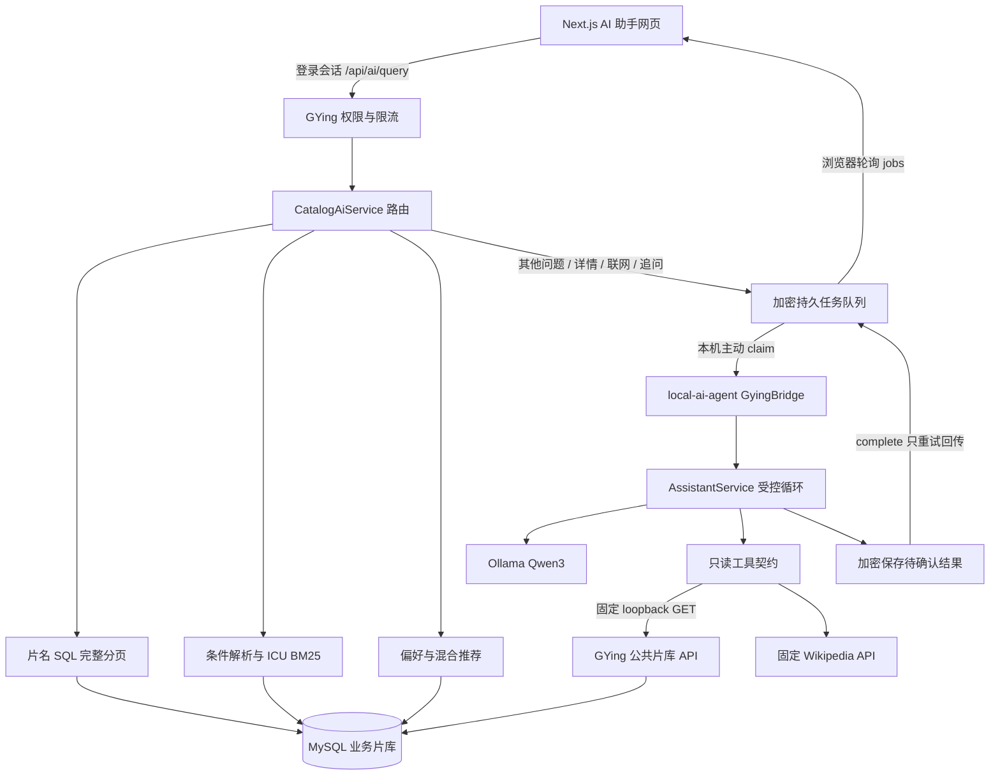
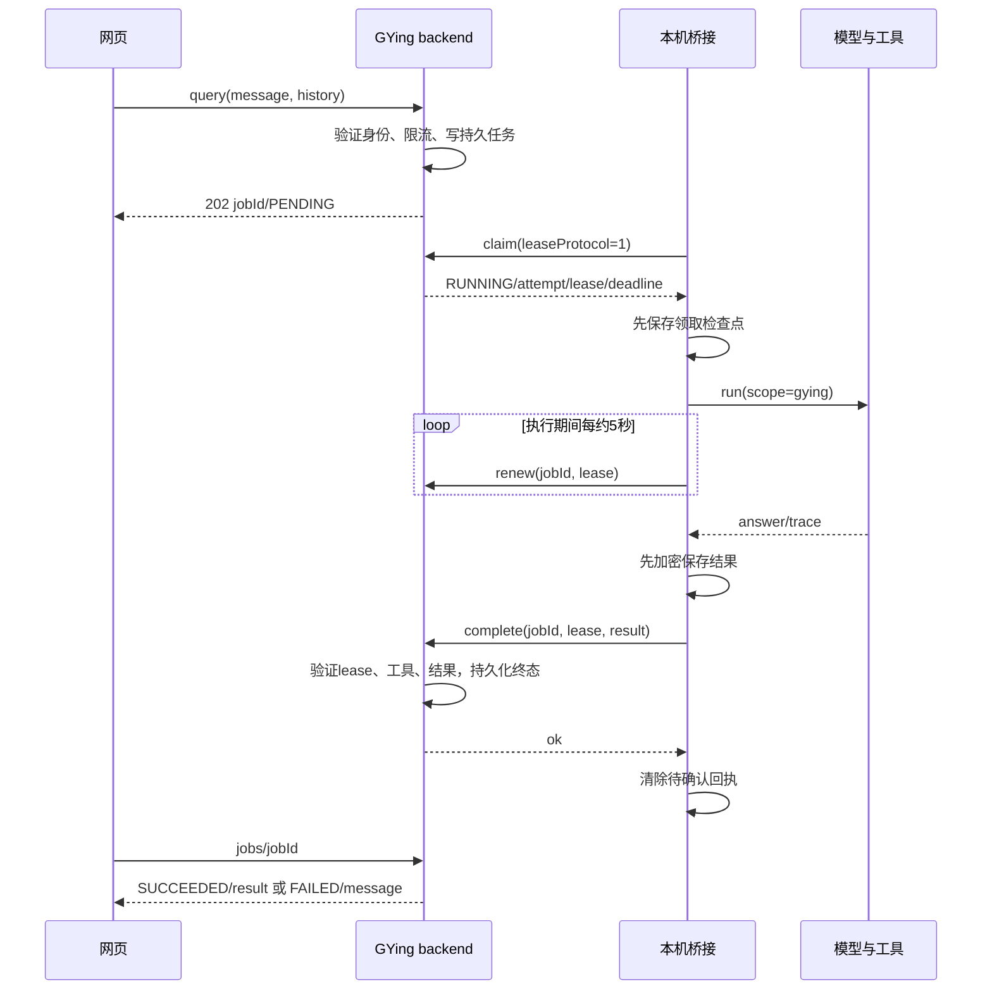

# GYing AI 整套链路：从网页问题到可核查回答

2026-10-23，Asia/Shanghai。本文按当前源码解释运行机制；在线部署基线见[当前状态](current-project-status.md)与[可靠性部署验收](ai-reliability-deployment-20261023.md)。评测工具在本轮交付，模型、prompt、网站业务实现保持现役版本。

## 1. 先认识三个职责

网页负责身份、提问、结果展示和对话历史；GYing backend 负责业务权限、检索/推荐和任务状态；local-ai-agent 负责受控模型执行。数据库才是片库、资源审核状态和用户偏好的业务来源。Ollama 是本机模型运行时。

这里的 Agent 指“模型在边界内选择工具、读取真实结果、再组织回答”的执行循环。Harness 是包住这个循环的工程机制：输入校验、工具契约、预算、trace、超时、幂等、租约和回执恢复。评测器则是外部验收程序，它发送问题、记录证据和检查结果，职责不同。

网站访问模型时走任务桥接，公网不直接访问本机 Agent。网页的身份凭据与桥接凭据是两套认证；普通用户无法领取其他人的任务。当前网站可以在模型离线时继续处理部分片名检索和推荐。

## 2. 一次网页提问的入口

[AI 页面源码](../frontend/src/app/ai-assistant/page.tsx)调用[api.ts](../frontend/src/lib/api.ts)，从浏览器 `auth-storage` 读取当前登录 Token，发到 `POST /api/ai/query`。服务端[控制器](../backend/src/main/java/com/gying/movie/controller/AiAssistantController.java)先验证真实账号/设备是否启用，再检查每用户每分钟 6 次的提问限流。

请求只允许 `message`、`history`、可选 `requestKey`。网站问题最多 1,000 字符；历史最多 8 条，即 4 组 user/assistant；历史严格交替，每条最多 6,000 字符，本轮合计最多 10,000。服务端固定 scope=gying，用户不能借请求切换到本机文件工具。

网页当前发送 `message/history`，没有发送 `requestKey`。因此后端已有幂等 API 能力，但当前网页未接入稳定的提交幂等键。网页限制并发和轮询，不等于刷新页面后自动找回任务；AI 页结果保存在 React 状态中，新对话清空这些状态。资源搜索页另有 sessionStorage 逻辑，不能把它当作 AI 页恢复能力。

## 3. 直接完成的三条业务路径

[CatalogAiService](../backend/src/main/java/com/gying/movie/service/impl/CatalogAiService.java)先判断是否能在业务层完成。简单路径返回 HTTP 200 与 `SUCCEEDED/result`，不进入模型队列。

### 片名检索

片名、英文名、别名和系列名使用带转义参数的 SQL LIKE；完整匹配优先，然后部分匹配，按年份/季/ID排序。先 COUNT 得到完整总量，再分页查结果；默认每页20，最大30。网页翻页请求 `/api/ai/search`。因此片库完整分页与小模型工具最多3条的候选是不同能力。

例如搜“星际穿越”会显示库内结果和年份；没有结果只代表本次片库查询未命中，不证明世界上不存在这部作品。片名中含“爱情”等类型词时，完整标题匹配优先，减少误分流。

### 自然语言条件与简介检索

[NaturalMovieQuery](../backend/src/main/java/com/gying/movie/service/impl/NaturalMovieQuery.java)使用规则提取年份、类型、类型排除、时长上限、评分下限、演员、导演、地区和语言；剩余文本进入[CatalogTextIndex](../backend/src/main/java/com/gying/movie/service/impl/CatalogTextIndex.java)。

索引做 NFKC 归一化、ICU 中文分词、停用词和手工中英概念扩展；片名权重4、别名3、类型/导演2、演员1.5、简介1。BM25 按文档频率与长度计算分数，手工概念信号乘0.65；查询词覆盖不足60%的文档会被排除，然后才展示命中理由和简介原文片段。分页端点是 `/api/ai/natural-search`。

它是稀疏词项检索和明确的概念词表，当前没有 embedding，也没有通用大模型语义解析。索引最多50,000条 ACTIVE 且未删除片目；缓存每60秒检查数据，数据完全相同时保留已构建索引。首次构建与温缓存请求时延不同，线上混合路由时延不能直接当作 BM25 冷/温性能。

当前条件支持必须按源码解读：

| 条件 | 现行语义与限制 |
| --- | --- |
| 多类型 | 要求同时包含所有已识别类型，尚无通用“或”表达 |
| 评分 | `max(豆瓣, IMDb, TMDB)`，不能冒充“豆瓣评分” |
| 时长 | 只有上限；90–100分钟不能据此宣称完整区间约束已实现 |
| 年份 | 固定年与年范围；“以后”从下一年、“以前”到上一年；部分“近N年”按当前年度计算 |
| 地区/语言 | 有限词表与字符串匹配；“日本导演”不等于作品地区是日本 |
| 情绪/镜头/奖项/版权 | 没有专门结构化字段及实时验证服务，不能保证条件被满足 |
| 昵称/错字 | 有别名检索，不具备通用演员错字纠正能力 |
| 追问 | 指代识别靠有限规则，业务检索器本身未保存每轮约束计划 |

“符合本次已识别的筛选条件”只指解析出来且数据库有支持的条件。用户原问题里未识别的条件仍需人工核查；评测器不能因为 HTTP 200 就把它们算作满足。

### 个性化推荐和相关推荐

[CatalogRecommendationEngine](../backend/src/main/java/com/gying/movie/service/impl/CatalogRecommendationEngine.java)从类型、导演、演员、类别、年代、地区、语言构建稀疏特征。自己的收藏作为较强信号，近90天浏览按约30天尺度衰减；已收藏/浏览的种子可排除。结合内容相似、有限的其他用户共同收藏支持以及评分/热度等信号给候选，每部附理由；无个人记录时按条件和片库质量回退。

用户身份不进入影片特征向量，其他用户身份不返回页面。相关影片使用当前影片作为种子，排除其自身；这也不是 embedding。`POST /api/ai/views`只对真实登录用户和有效片目记录浏览，30分钟内去重。纯评测提问不会为了制造个性化自动收藏或浏览影片。

## 4. 需要模型时发生什么

业务层无法直接回答的问题提交到[AiAssistantService](../backend/src/main/java/com/gying/movie/service/impl/AiAssistantService.java)。后端返回 HTTP 202 与 `jobId/status`。网页每2.5秒轮询 `/api/ai/jobs/{id}`，最多约250秒，只有 `SUCCEEDED` 才显示回答。

本机 GyingBridge（另一仓库 `local-ai-agent/backend/src/main/java/com/localai/agent/assistant/GyingBridge.java`）主动轮询已有后端，维护线程发 heartbeat 和 renew，避免长推理阻塞续期。网页不需要知道本机 IP 或 bridge Token。

### 模型循环和真实工具

本机 AssistantService 使用 Ollama 原生 `tool_calls`。每轮把允许的工具 JSON Schema 交给模型；模型返回结构化调用后，程序检查名字、参数、预算，执行工具，再把 JSON 结果作为 tool 消息回传。模型写出类似调用 JSON 的普通文本不会被当作真正执行。

当前 gying scope 恰好三个工具：

| 工具 | 数据来源 | 边界 |
| --- | --- | --- |
| searchMovies | 固定loopback `/api/movies/list` | keyword<=60，可选year/category，limit<=3；第一页候选 |
| getMovieDetails | 固定loopback `/api/movies/{id}` | id应来自实际候选；详情和已审核 NORMAL 存量资源 |
| searchMovieWeb | 固定 zh/en Wikipedia API | query<=120，language=zh/en；百科资料摘录，不是全网版权检索 |

模型不能选择 HTTP 主机、方法或任意路径；不跟随重定向、不用代理，不提供写入/转存/修复/发布工具。资源 `queriedAt` 是本次读库时间，`validatedAt` 是历史检查时间，NORMAL 是库内状态；都不能证明当前外部链接能下载。

正常循环默认最多4次工具、6轮、总时限180秒；GYing公共片库工具网络请求有更短时限，百科请求也有独立时限。单请求信号量保证本机模型单并发；桥接与直连评测器同时调用会竞争这个预算。本轮重叠运行留下了干扰记录，后续有效性能测量必须串行。

上下文配置4096、输出上限768，另留384 framing/估计余量；程序以保守字符估计检查容量，先删早期历史，再裁剪工具条目或摘要，并标记 history/evidenceTruncated。它不是提供方真实 token usage。超长、多轮候选多、详情复杂时可能得到 CONTEXT_LIMIT；不能从有限历史推断长期记忆已经实现。

百科路径返回实际原文片段和来源链接，服务端展示 attributed excerpt，减少小模型改写情节带来的事实风险；片库自由文本回答仍需人工核查，真实调用工具本身不保证整段回答都正确。

## 5. 任务恢复覆盖哪些情况

| 机制 | 已实现行为 | 实际限制 |
| --- | --- | --- |
| 用户隔离 | job绑定userId，其他用户读取返回404 | 不是无身份的共享队列 |
| 提交幂等 | 同用户requestKey+同请求复用，内容变更409 | 当前网页未发送requestKey；保留窗口有限 |
| 有界队列 | 总记录最多200，未结束最多8，一个RUNNING | 每用户已有未结束任务时返回现有任务；不是任意分布式吞吐 |
| 可续期租约 | 新协议45秒租约，持续renew；旧协议210秒 | 到任务创建后240秒仍未完成则失败 |
| 有限attempt | 可续期任务租约丢失且attempt<2可回PENDING | 再次领取是新的attempt，不承诺全局exactly-once推理 |
| 完成幂等 | 同lease、同结果摘要重复complete成功 | 过期/错误lease或矛盾回执409，不覆盖新状态 |
| 取消 | 用户取消转FAILED，保留“已取消”说明 | 网页Abort不自动调用DELETE；不会立即终止已发出的模型推理 |
| 后端持久化 | 保存任务/attempt/lease/终态；启动恢复 | 终态约15分钟后清理，不是长期审计库 |
| 本机回执恢复 | 已有result时重传complete，不重跑模型 | 中途无result的attempt恢复为中断失败，不从某次工具后续算 |

可以这样区分：模型算完了，回传确认丢了——本机重传同一回执；模型算到一半进程退出——当前本机恢复报告中断，不能恢复工具循环的中间上下文。后端自身的租约过期重领可以产生新的attempt，这与“本机不自动重放未完成推理”同时成立。

状态文件用[AES-GCM存储实现](../backend/src/main/java/com/gying/movie/utils/EncryptedAiState.java)，含认证、随机nonce、单写者文件锁、受限权限、先写临时文件/force再原子替换。密钥、state、实际覆盖位于仓库外并纳入加密备份。密文身份认证失败会阻止恢复；不能静默丢弃状态后继续运行。备份完整与恢复可用分别验证，见部署验收。

## 6. trace、审计与证据

一条回答有 requestId；模型步/工具步带名字、状态、耗时，工具步还含真实结果。GYing完成回执时筛选三工具，拒绝未授权工具；没有实际证据、工具失败或空回答会转FAILED。页面可展开简化轨迹。

本机 TraceStore 是最多200条的内存feed，重启后不保留。后端任务state虽然暂时保存结果，不等于长期调用审计。当前响应链上的 trace、临时加密状态和本轮脱敏评测报告是三种不同证据；全生命周期审计、token usage与按用户成本账本仍待做。

## 7. 本轮评测如何围住这套链路

[可比较评测说明](ai-comparable-evaluation-20261023.md)区分两套入口。本机回归器直接调用既有 `127.0.0.1:5000/api/assistant`，检查模型工具路由、实际参数、候选事实、空结果、拒绝和ID追问。网站留出器以普通USER登录调用真实 `/api/ai/query`，覆盖业务分流、队列、桥接、结果与历史；它没有模拟浏览器UI，页面刷新与真机仍需单独验收。

你的30题原文保持，拆成44轮，多轮同组、演员/系列等相近题共用来源组。题目和验收口径用hash冻结；模型输出只作为本次观测用于复核，没有冻结为标准回答，也没有用题目调prompt。第27题先确认评分来源，不能预判“未拿奥斯卡最佳影片”构成逻辑矛盾。

片库快照保存10,432条元数据，便于下一阶段离线对比BM25/embedding/混合检索。线上本轮仍查询真实活库，不能把有一份快照说成线上实验已经使用同一冻结语料。独立问题也不自动产生独立人工标签或100%质量结论。

## 8. 后续学习与实现顺序

先完成这些回答的人工复核并整理共性问题；质量差异按分流、解析、候选、回答、拒绝、多轮定位。未来prompt/规则改进需要新的development集；这30题已用于观测并保持留出政策，不能把逐题修补说成盲测提升。之后扩题时按sourceGroup划分，并确认标注来源与数据时点。

检索下一阶段先在本轮元数据快照上完成冷/温BM25基线和独立相关性标注，再比较embedding/混合与可选rerank。内容镜头/分级、精确豆瓣、平台版权等需要数据契约先完善。Spring AI迁移应保持原有工具和预算；只读影视MCP需要新建工具集合，旧MCP含命令/写文件/外发工具，不能直接宣称已用于这里。

可用这条演示讲清项目：登录用户提出问题 → 展示路由与依据 → 追问候选ID → 展开模型工具trace → 展示回执重复回传不重复推理的恢复测试 → 展示独立留出题失败和人工复核。可靠性改善可由恢复测试支撑，回答质量改善要由同数据/同标签/受控实验支撑。
