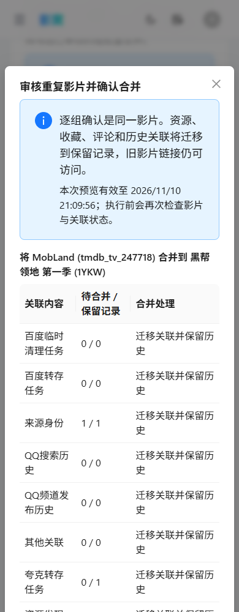
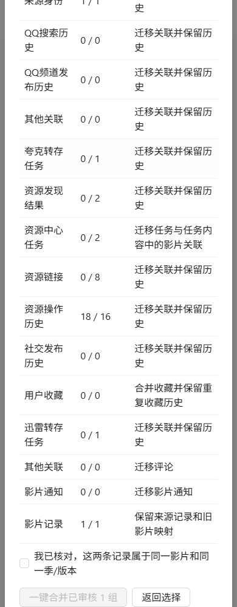

# MobLand 历史完成凭证兼容修复与真实预览验收

2026-11-10 20:06:37（Asia/Shanghai）仅backend激活固定源码 `0bba123db30867e0ea2cf045ae2ed0976104bb16`；20:46:38完成补充运行态核验，21:00:24完成真实UI验收；21:59:13新post三age、22:02:58日常44项及22:04:21最终只读保持通过。MobLand `tmdb_tv_247718 -> 1YKW` 现役预览eligible/canMerge=true、blockers=[]、资源0/8。影片尚未合并，八条资源和历史任务保持。本次有一次原运行态门禁FAIL和一次原浏览器选择器FAIL，原回执不改，补充验证单独记录。

## 修复与隔离验证

夸克SUBMITTED仅在已完成任务、严格自有分享身份、对应discovery、已批准且NORMAL的非临时DISK资源及验证时间形成完整链时兼容；凭证纳入快照、指纹和锁，请求/响应须为JSON object，递归不确定节点仍拒绝。目标自身合法v1/v2终态P2P上游根mid仅在mid=保留目标时忽略；源mid、反向方向和其它嵌套引用仍阻断，payload不改。全局终态/不确定规则和原34触发器保持。

[完整suite独立复核](full-suite-independent-review.json)：1434项，1433通过、1既有Redis跳过、0 failure/0 error；MovieDuplicateMergeMySqlTest真实MySQL 24/24，其中本次新增8项覆盖保存、缺证/伪造、不确定状态、URL身份规范化、指纹/锁漂移、目标P2P历史及迟到写入保护。Java17 compile、416源文件/440类资源绑定和测试容器清理通过。[构建](backend-build.json)network=none、package时testsRerun=false，没有加载生产环境/挂载/端口。

实际镜像 `sha256:daaeafd28dde4647f07da2cf0a58ba385f3ab1b2c181e6cc6948b52472d18bae`，JAR `2f8657ab78c864f6ab5ef31ca257c69ff529b024d2f6359444dd301ca263a59a`。[候选绑定](candidate-binding.json)、[助手离线8项](acceptance-offline.json)、[运维离线](ops-offline.json)和[补充验证离线](verification-offline.json)保留；离线检查不算生产或浏览器验收。

## 一次激活、原runtime FAIL与独立补充验证

[原部署](deployment-original-failed.json)20:03:29开始，旧backend正常TERM停止，停止窗口七age内容认证后，20:06:37仅一次candidate激活并ready。20:06:55原 `ACTUAL_RUNTIME_ONLY_IMAGE_CHANGED` 门禁失败，candidate保持运行，未再次激活、强停或回退；原门禁/FAIL回执未修改。本次未执行nginx重载。

原计划保存旧原始Config哈希，没有保存旧Env顺序与完整旧容器labels，不能证明旧/新原始序列完全等同，也不能将FAIL仅归因Env排序。[补充回执](verification-completed.json)/[绑定](verification-binding.json)验证全部17个现役Config字段、153个唯一Env键值、baked/custom labels、严格生成Compose metadata、旧HostConfig/网络/挂载、固定镜像/JAR和完整有效Compose模型，当前raw Config/HostConfig在验证起止期间稳定。固定镜像配置仅两项来源labels变化，相对认证的旧有效模型只变backend image；其它12容器代次和保护历史保持、additionalServiceActivations=0。补充结论不声称旧raw序列/labels完整哈希相等。

backend原20份Compose追加本release candidate后为21层；frontend原12层、镜像 `sha256:7e172578b6f954bb368e973a7dca5331747e99b0963a6d6b74896942b42e52ad` 和12:34:59代次保持。原frontend构建来源 `63edac7e98f9723458e9742c276e416437d4f254`、375产物/194资产验证属于早前证据，本次未重跑。

停止窗口检查点 `G:/gying-backups/mobland-merge-compat-20261110-20261110T120357.471400Z` 的7份age，manifest SHA `ecaf978eaa3ea9bb3f80724fe9723412b6649781c1e1238942f20f98dcef7f8b` 完整认证；72配置成员、882host成员/1374ACL、SQL31表/1过程/34完整保护、7backend-data、队列/key、当前百度会话AES-GCM/同账号/同volume/0600与0700/UID10001核对通过。不导入SQL/data、不写明文归档，不称跨服务原子快照；回退材料保留，回退仅应用、保持当前SQL/data/state/key。

## 20个入口、两次scan/preview与两张新图

20:49–20:50[第一次验收](acceptance-original-selector-failed.json)完成本机/经既有7897代理公网20个单次匿名GET全部通过：页面/片库200；源站两个匿名admin API401，公网管理页与两个admin API精确现有HTTPS Cloudflare Access302（未跟随），internal/QQ三个路由404。第二次明确引用这20个已通过结果，没有额外匿名GET。

[第一次browser](browser-original-selector-failed.json)已扫描15756/145/page1，唯一MobLand方向preview200、eligible/canMerge=true、blockers=[]/resource_link0/8。旧助手把input自身data-testid当成父节点找子input，等待选择器失败，未截图；无pageerror、其它未授权API、merge/cloud动作，完整保护行保持。此FAIL和已成功的首次preview保留。

[补充绑定](ui-selector-binding.json)仅增加正确input选择器副本和一次create-only手工尝试，原文件不改、automaticRetry=false。UI验收阶段合计20个匿名GET、2次完整dryRun scan POST、2次精确preview POST，scan/preview均200；第一组因选择器未完成截图，第二组是真实通过的一组，不称全程一次preview。

20:59:30–21:00:24[补充验收](acceptance-ui-passed.json)/[browser](browser-ui-passed.json)复用已有ADMIN设备，300秒JWT仅内存/stdin、incognito context闭合，无登录/新device。localhost zh/light/390完整扫描15756/145/page1，唯一 `tmdb_tv_247718 -> 1YKW` 预览eligible/canMerge=true、blockers=[]、resource_link0/8。确认框始终未勾选、merge按钮disabled、未点击；新390x1000顶图和原生滚动动作图均有SHA，documentWidth=viewport=390、动作可达。必要GET和scan/preview才发送，现有page-view telemetry POST拦截，merge/cloud未尝试。

验收前后完整sys_config89行、两影片identity/metadata、八resource_link，夸克1481/discovery5784、P2P7803/7804和百度hub17580/17583/17584/17606/17622及transfer1的完整行哈希保持。两条review创建及已有device常规last_seen更新属于允许记录更新；未合并或改历史。

## 依赖与日志的实际范围

20:03[部署前配置路径复验](deployment-original-failed.json)覆盖gying_app@%只读DB、认证Redis PING及实际source/quark/publisher GET；PanSou仅backend TCP可达，不称service health验证。[MinIO认证既存对象GET](minio-authenticated-read.json)由现有frontend Node peer在backend网络用当前backend配置 `host.docker.internal:9000` 及S3凭据完成，HTTP200/155434字节image/jpeg、零object write/provider request。证据为peer认证读取，不是backend本进程上传/读取业务；未改配置/重启依赖。旧三个published-port RemoteDisconnected和peer ECONNRESET保留原时点，具体组件原因不定。

[短日志](candidate-log-check.json)仅查20:06:37–20:19:53本candidate Docker stdout1213字节/stderr0，ERROR/Exception/OOM匹配0、restarts0/OOMKilled=false；应用文件日志未验，不能外推全时段。

[最终Docker日志](final-read-only-passed.json)覆盖candidate启动20:06:37至22:03:57的Docker输出，最多tail2000行：stdout2029字节/stderr0，ERROR/Exception/OOM匹配0。它是该截止时间和行数边界内的双流检查，应用文件日志仍未验。

## 宿主pin、日常覆盖与保留边界

21:03:56–21:04:14[第一次host pin](host-pin-original-failed.json)已经唯一CAS写入当前candidate的expectedBackendImage，privateConfigurationWritten=true、onlyExpectedBackendImageChanged=true、configurationOutcomeUnknown=false、owner/group/DACL保持；随后严格host snapshot抛出RuntimeError，原FAIL回执保留，此次未完成post检查点。

21:48:44–21:48:51[第一次补齐](host-pin-completion-original-failed.json)在reservation/capture前被完整host内容门禁拒绝，configurationOutcomeUnknown=true、观察到post检查点0；这是该次失败观测，不用首次pin的false覆盖。[只读诊断](completion-member-diagnosis.json)随后认证实际882个归档成员、全部原880文件及metadata哈希，定位补齐脚本预期881个成员，唯一遗漏已知57字节 `host-checkpoint-state.json`；未创建reservation/post-plan或检查点、productionChanges=0。该诊断不是新备份完成证明。[V1绑定](host-pin-completion-binding.json)、[6项离线](host-pin-completion-offline.json)和[独审](host-pin-completion-independent-review.json)均保留。

21:57:33–21:59:13[V2真实补齐](host-pin-completion-v2-passed.json)按[V2绑定](host-pin-completion-v2-binding.json)精确纳入该一个已知成员，仅核验已写pin并完成单次新post检查点；未再次CAS或激活服务。总host配置CAS1/追加0、configurationReplaceAttempted=false、additionalServiceActivations=0；当前配置仅expectedBackendImage变化，owner/group/DACL、完整taskXML/ACL/profile/880host文件、实际backend与其它12容器代次及保护历史前后保持，configurationOutcomeUnknown=false由本次真实前后核验重新证明。[V2离线10项](host-pin-completion-v2-offline.json)/[独审](host-pin-completion-v2-independent-review.json)通过，complete故障注入仍未覆盖，不替代此次实际capture与收尾门禁。

新检查点 `G:/gying-backups/mobland-merge-compat-post-pin-20261110-20261110T135807.764347Z` 的3份age完整认证/内容通过，manifest SHA `4851b6dc5be5170f12e33ea80bf32b75bfcc1a30fdd970c19b02b7527e147019`；host完整内容、归档队列与key认证（pending0/running0）、百度AES-GCM/当前pair/同volume/同账号/UID10001及0600/0700权限通过。未导入SQL/data/state/key，不称跨服务原子快照。原R2 16:17 pin/16:22三age/16:28日常43项CAS属于历史，不代本次新检查点或覆盖。

[日常准备](daily-prepared.json)以实际43项配置为基线，仅提出新增 `E:/gying-tools/releases/mobland-merge-compat-20261110` 一个release路径，原生before43/proposed44 dry-run通过。原日常配置的单份age检查点 `G:/gying-backups/mobland-daily-config-before-20261110-20261110T140048.122349Z` 完整认证且与原配置preimage完全一致，manifest SHA `dd00285c28286e5127d3a350de9e1b2c8c3a39d16e0e512dbbfece3ee276a795`。

22:02:00–22:02:58[实际日常apply](daily-apply-passed.json)唯一CAS仅新增该release路径，privateConfigurationWritten=true、onlySingleReleasePathAdded=true、configurationOutcomeUnknown=false；原生before43/proposed44/after44 dry-run、owner/group/DACL及前后idle通过。当前日常覆盖44项，未执行完整备份、自然完整备份仍未验证；无SQL/cloud/service/merge动作。22:03:52–22:04:21[最终只读保持](final-read-only-passed.json)另执行源站片库API/同片详情2个匿名GET，各HTTP200；这是UI阶段已通过20个入口以外的2次校验，两阶段入口校验合计22个匿名GET。最终candidate同代次/实际JAR/17个Config字段/153Env与有效模型、其它12容器代次、完整host taskXML/ACL/profile/880文件、当前pin/日常44及89行sys_config与指定影片/资源/历史ID的保护整行前后保持，五idle计数均0。无新增preview、SQL/cloud/merge动作。

本次未合并MobLand或其它候选，八资源和原任务保持。Troll中英/明暗/390/1280八组确认开关/16截图、R2 23GET/375产物只引用[历史](../baidu-runtime-merge-metadata-20261110/README.md)，本次未重跑八组或将旧图当新图，原R2及更早FAIL保留。

百度额度3/3已用完：前两条SKIP、第三条17622 UNKNOWN、17584/17606旧UNKNOWN和父17583 PAUSED/关闭十分钟1条/rev63/processed5/skipped5/succeeded0/failed0/deferred3保持。本次无第四次测试、重放/resolve、恢复调度、转存、自有分享/临时删除、QQ/GYING发布或自然一轮，真实归档仍未成功。安全历史58 PASS/11 FAIL/1 UNKNOWN、G01–G11未关闭，不冒充新审计或加固。

脱敏回执和两张新图的原路径/SHA见[evidence manifest](evidence-manifest.json)。未复制JWT/.env/Cookie/原inspect/SQL dump/会话/密钥或age正文。
