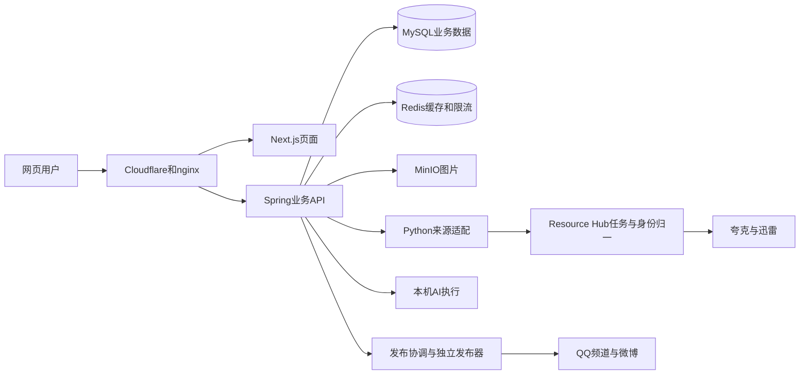

# 项目知识导读：从业务问题理解工程设计

本文按2026-10-25源码与已有证据解释GYing Movie。它回答“为什么这样设计、在哪核查”，运行版本见[当前状态](current-project-status.md)，AI完整流程见[AI架构](ai-architecture.md)。代码能证明实现，测试/运行记录能证明特定场景，二者都不能自动证明所有线上效果。

## 1. 项目解决什么问题

项目把电影、剧集和动漫元数据归一为片库，关联审核资源，提供检索、收藏评论、推荐与资料问答；Resource Hub负责元数据采集、候选治理、自有分享和独立发布任务。网页是业务入口，AI是受控查询能力，网盘和外部平台是另一类有副作用的集成。

核查入口：[根README](../README.md)、[生产Compose](../docker-compose.prod.yml)、[Resource Hub](resource-hub.md)。Compose包含目标配置，实际启用项还要对照运行覆盖、sys_config和任务状态；仓库文件不能代替在线观测。

## 2. 为什么拆成几个服务

| 组件 | 它负责什么 | 可以学到什么 |
| --- | --- | --- |
| backend | Java17/Spring Boot API、权限、片库、任务与协调 | 分层Controller/Service/Mapper、参数边界、持久状态和事务 |
| frontend | Next.js/React页面、SSR、交互、国际化 | 服务端/客户端职责、hydration、请求竞态和错误状态 |
| crawler/source | Python外部来源适配、元数据和P2P读取 | 上游协议、会话、限额、解析和来源异常隔离 |
| social-publisher | 独立Node发布器 | 外部平台调用、内容文件和回执不确定性 |
| local-ai-agent | 另一仓库的Java模型执行层，Vue仅为本机只读页面 | Schema、工具边界、检索、预算和Harness |
| OpenClaw/宿主计划 | 已有机器人、频道CLI、Tunnel、迅雷同步和重启协调 | 独立身份、运行目录、计划触发与系统恢复 |

[backend/pom.xml](../backend/pom.xml)、[frontend/package.json](../frontend/package.json)、[social-publisher](../social-publisher)、[crawler](../crawler)可核对依赖和真实实现。不同进程隔离职责，不表示已经是完善的分布式微服务平台；当前不少任务只支持单实例。

## 3. 一次请求怎样到达业务代码

公网域名经Cloudflare Tunnel进入宿主loopback nginx，同域 `/api` 转到Spring，页面与静态资源转到Next.js。生产浏览器API前缀为空，SSR访问内部后端；容器中的localhost指容器本身，容器访问宿主需采用实际网络路径。

核查：[API客户端](../frontend/src/lib/api.ts)、[nginx配置](../nginx/nginx.conf)、[部署](deployment.md)。网络失败按源站、内部依赖、Tunnel和公网分层查，不能看到网页HTML200就认为后端/AI也可用。

HTTP状态表示传输/接口结果，业务状态表示任务完成与否。AI可能HTTP200但业务code500，也可能返回202表示已入队；任务SUCCEEDED仍只说明形成了可展示结果，回答质量另评。404、401、405和429有各自契约，不应为降低错误率而隐藏正常拒绝。

## 4. 登录、权限和设备吊销如何配合

[AuthHelper](../backend/src/main/java/com/gying/movie/utils/AuthHelper.java)校验Bearer JWT、用户是否启用和登录设备jti是否有效，受限接口按本次读取的角色检查权限。JWT签名通过不代表设备仍获授权；更改密码/吊销会话需影响设备记录。ADMIN和PUBLISHER权限由服务端决定，页面按钮隐藏不够。

浏览器在本地恢复已登录token，由[API客户端](../frontend/src/lib/api.ts)添加请求头；401会清本地状态并回登录页。持久化本地token便于刷新恢复，也要求防XSS、避免日志泄漏；不把token放进查询URL。Cloudflare Access保护部分边缘管理路径，网站JWT与角色仍需独立验证。

核查：[认证接口](api.md#认证与账号)、[安全架构](security/security-architecture.md)、[Cloudflare](security/cloudflare-security.md)。Access/网站身份/内部bridge认证是三层不同边界。

## 5. MySQL数据模型为何区分影片、资源和来源身份

`movie_metadata`是本地canonical影片，`resource_link`是关联资源，`movie_source_identity`保存TMDB/GYING等外部身份。一个本地影片可以对应多个来源和多条资源；外部id不应该直接等同本地主键。

GYING id大小写敏感，`dWXo`与`dwXo`不能合并，已采用utf8mb4_bin。片名相同、年份相近仍可能不同片；季与合集还需要主创和明确范围证据。模糊相似用于候选，确定身份用于绑定，不能只按标题覆盖。

核查：[数据库与24个增量文件](database.md)、[身份迁移](../backend/src/main/resources/db/migration_source_identity_case_sensitive.sql)、[Resource Hub](resource-hub.md)。schema有23张表声明，原生产证据有25表；两张QQ日志表未合入schema，新库初始化和已有库升级必须分开。

## 6. 为什么保留历史、软删除与bindingVersion

审核状态、软删除和资源有效性是不同字段；过滤要同时检查目标影片、资源审核、ACTIVE和未删除等条件。软删除保留追溯关系，合并迁移关联而非物理删数据。资源绑定编辑携带bindingVersion，用于发现基于旧版本提交的修改；取消勾选不代表删除历史行。

SQL的AND/OR括号、NULL语义、参数绑定和LIKE转义都影响结果与越权边界。例如“属于当前影片 AND (有效性为NULL或不是INVALID)”不能把OR放在整个过滤外面。更新通知按user_id与未读条件执行单条UPDATE，不逐条循环，也不能引用该表没有的deleted_at列。

核查：[资源API](api.md#资源)、[QueryBoundaryMySqlTest](../backend/src/test/java/com/gying/movie/service/impl/QueryBoundaryMySqlTest.java)、[数据库](database.md)。乐观版本、索引与单条更新改善边界，但不能据此声称生产无锁等待。

## 7. Redis为什么同时做缓存和限流

缓存减少重复查询，业务片库仍由MySQL提供。非关键搜索热词/统计更新失败可以不破坏成功查询；鉴权限流失败则保守拒绝，不能静默放行。两类失败策略由业务重要性决定。

[RedisRateLimiter](../backend/src/main/java/com/gying/movie/security/RedisRateLimiter.java)用Redis TIME与Lua，在一个原子脚本内清理滑动窗口、计数、写入事件和过期；identity经过hash生成key。若把这些操作拆成客户端多次读写，会出现并发竞争；用一个进程的本地计数也不能代表全部请求。

片库进程快照TTL60秒、最多50,000条，按需文本索引。TTL过期后仍可能冷加载；较小的热查询耗时不代表所有请求。核查：[CatalogAiService](../backend/src/main/java/com/gying/movie/service/impl/CatalogAiService.java)、[缓存与限流代码](../backend/src/main/java/com/gying/movie/security/RedisRateLimiter.java)。

## 8. 搜索、推荐和AI回答有什么区别

标题搜索以片名/别名/系列匹配和分页为主；推荐利用本人收藏/衰减浏览与内容特征排序；AI把复杂中文转换为受限计划，再用片库、BM25/BGE-M3和真实来源形成候选/回答。不能用“模型说喜欢”替代推荐特征，也不能用向量分替代明确年份/人物条件。

BM25强调查询词在文档中的重要性；embedding把文本转换为向量，归一后的内积用于语义相似；RRF融合排名；相关性核对再看实际简介。每层可能失败，所以需要看到分流、queryPlan、候选与trace，而不是只换更大模型。

核查：[AI架构](ai-architecture.md)、[CatalogTextIndex](../backend/src/main/java/com/gying/movie/service/impl/CatalogTextIndex.java)、[推荐引擎](../backend/src/main/java/com/gying/movie/service/impl/CatalogRecommendationEngine.java)。现有向量索引不是专用向量数据库，影片检索也不代表已交付通用文档RAG。

## 9. Resource Hub如何避免重复采集和错绑

TMDB/GYING各来源有独立范围、下一页与页内偏移；payload.crawl和任务终态共同保存。范围变化保留仍在范围内的位置，越界才重置。来源榜单会变化，因此断点续采并不是固定数据快照，写入仍需幂等。

失败项目持久化为独立METADATA_ITEM_RETRY后才允许推进；全部失败、缺身份或隔离保存失败不推进。重试有退避和次数上限，耗尽保留；SUCCEEDED且deferred>0只代表失败被隔离，不代表每个项目成功。

核查：[Resource Hub机制](resource-hub.md)、[任务服务](../backend/src/main/java/com/gying/movie/service/impl/ResourceHubTaskServiceImpl.java)、[Worker](../backend/src/main/java/com/gying/movie/service/impl/ResourceHubWorkerServiceImpl.java)、[周榜](metadata-weekly-transfer.md)。元数据采集与视频转存分离，避免高频采集自动产生大规模网盘副作用。

## 10. 网盘、P2P和分享链路为什么要分阶段

候选来源 → 按provider保存 → 核对完整落位 → 创建自有分享 → 验证 → 入resource_link，每一步可能有独立失败。QUARK与XUNLEI的路径、token和接口不同，不能套用同一修复方法；旧有效分享尽量复用保存目录原位重分享。

P2P归档保存筛选后的磁力/种子小文件并分享到双盘，不等于保存完整视频；登录账号 `/dbt/` 下载地址与可公开磁力/种子地址分开。WAITING_SHARE、NORMAL、queriedAt和validatedAt分别表示阶段、库内状态与不同时间，不能由HTTP200保证当前能下载。

核查：[P2P采集](gying-p2p-collection.md)、[归档](p2p-cloud-archive.md)、[单条修复](resource-hub.md#失效资源单条修复)、[API](api.md#gying)。真实转存、修复和分享不是默认只读健康测试。

## 11. 为什么外部发布不能盲目重试

本地数据库和远端平台之间没有共同事务。平台已收帖但本地未收到确认时，第二次发送可能重复。发布先用条件UPDATE认领并持久化PUBLISHING，再调用远端；成功POSTED，不确定结果UNKNOWN或保留在途，由人工核对平台与本地回执。

“单logId条件认领”“同回执幂等”与“同影片跨版本全球只发一次”是不同保证，当前没有后者。不能把UNKNOWN批量改回PENDING，也不能以旧dump撤回远端已发生的帖子。

核查：[发布状态机](social-publishing.md)、[SocialPublishingService](../backend/src/main/java/com/gying/movie/service/impl/SocialPublishingService.java)、[QQ频道](qq-channel-multi-drive.md)。QQBot每日推荐属于backend链路，原频道CLI与social-publisher另有职责；NapCat已停用。

## 12. 前端为什么需要请求取消和竞态保护

用户快速换筛选/页码时，旧请求可能比新请求晚返回。AbortController取消等待、effect清理与请求版本/单飞保护共同避免旧响应覆盖新状态；分页失败保留旧结果便于重试，批量已读完成后再刷新正确页。

SSR与初始客户端语言/主题一致有助于避免hydration差异，挂载后再恢复浏览器偏好。手机端卡片/按钮适配和headless视口测试能覆盖布局，却不等于iOS/Android真机。核查：[热门页](../frontend/src/app/hot/page.tsx)、[通知页](../frontend/src/app/notifications/page.tsx)、[监控hook](../frontend/src/hooks/useMonitoringData.ts)、[开发测试](development.md)。

## 13. 异步任务、lease和幂等如何连接

job表示用户任务，attempt表示一次执行尝试，lease表示当前执行者在有限时间内的所有权，checkpoint表示已保存进度，receipt表示结果确认材料。续期保持长推理所有权，过期旧lease不能覆盖新attempt。

AI的完整回执落盘后可只重传，不再次推理；只保存领取检查点时报告中断，不续算工具中间状态。外部发布的“不确定”还要核远端，两者不能套用同一自动重试规则。核查：[AI恢复](ai-architecture.md#7-租约回执与恢复)、[AiAssistantService](../backend/src/main/java/com/gying/movie/service/impl/AiAssistantService.java)、[加密状态](../backend/src/main/java/com/gying/movie/utils/EncryptedAiState.java)。

## 14. 部署、备份和计划任务怎样证明有效

源码提交说明代码来源，镜像/JAR hash说明运行产物，健康/真实入口说明特定调用正常，日志窗口说明当时未见异常。固定候选、只换受影响服务、核有效覆盖并保留旧包，可以避免顺带改动未审查依赖。

备份文件存在、hash一致、age完整认证解密、隔离恢复、异机端到端恢复是逐步增强的证据；普通业务dump不含完整系统账号。当前发布检查点不等于灾难恢复演练。Windows任务Ready表示已注册待运行，不等于已经重启；超时取消、优雅排空与登录恢复还需真实观察。

核查：[部署](deployment.md)、[迁移](../MIGRATION.md)、[备份](security/backup-plan.md)、[每周重启](weekly-graceful-restart.md)、[迅雷同步](xunlei-token-sync.md)。迅雷脚本会临时启动headless Edge读取私有会话副本，正常finally关闭本轮实例；普通常驻Edge是另一组进程，不能把两者混为同一内存来源。

## 15. 怎样判断一次性能或质量改进可信

先固定数据、题集、标签、版本、配置、冷热状态和负载，再比较同一指标。合成计算的中位加速不能改写为线上p95/QPS/CTR；独立用户编题不等于已有独立人工相关性标签；模型完成请求不等于满足需求。

当前有真实SQL隔离测试、浏览器mock API场景、匿名线上入口、真实模型/队列和用户网站题，它们覆盖不同层。遇到“测试通过但答案差”，先核测试是否只检查执行成功，再检查条件理解、候选事实和需求命中。核查：[评测手册](ai-evaluation.md)、[独立30题](evaluation/human-holdout-v1/README.md)、[发布证据](history/releases.md)。

## 16. 建议的源码学习顺序

先沿网页→Controller→Service→Mapper/SQL读一条标题查询，再读权限和Redis限流；接着沿Resource Hub读一次元数据任务与provider保存；之后读发布的条件认领/UNKNOWN。最后按[AI源码顺序](ai-architecture.md#10-源码阅读顺序)读queryPlan、混合召回和回执。

每个模块记录“输入、可信来源、状态、正常结果、失败结果、并发边界、可以验证什么”。完成一个正常例和一个失败例后，用[求职路线](ai-career-roadmap.md)整理可演示设计，而不是按工具名堆技术关键词。
